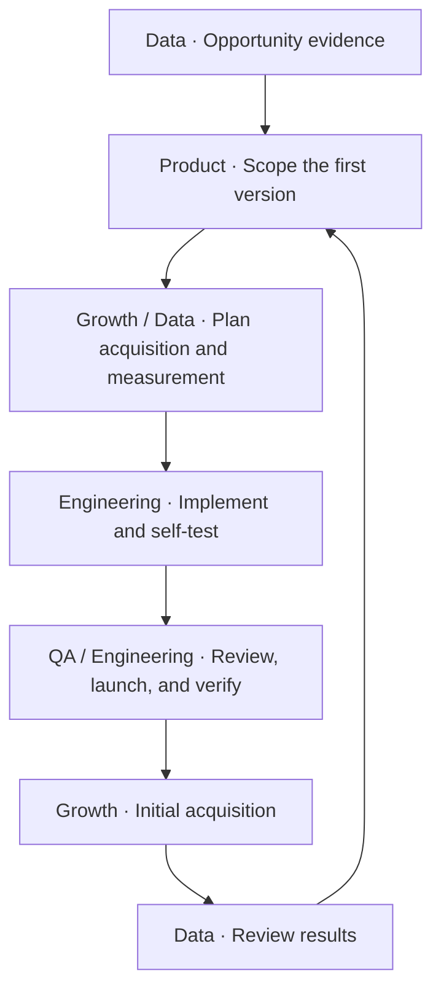

# Web Product Workflow

**English** · [简体中文](README.zh-CN.md)

An Agent Skill for independent makers and small teams. Take a Web or SaaS opportunity through competitor research, product definition, implementation, independent acceptance, initial acquisition, and review. Each task has an owner and each handoff has clear pass conditions and evidence.

## Who it is for

- **Indie developers and small teams** who have a web product idea and want their AI assistant to turn existing notes into a first version they can evaluate.
- **Product owners using AI to build** who want separate responsibilities for requirements, implementation, and review, with fewer repeated explanations and fewer regressions.
- **Site operators** who want to connect acquisition experiments, successful use, payments, and costs to choose the next improvement.

Provide a project goal and the access it requires. Code editing, tests, independent review, and deployment depend on the client and its tools.

## Getting started

1. Download this repository. Copy the complete [`skills/web-product-workflow`](skills/web-product-workflow/) folder into the target project's `.agents/skills/` directory. If a skill with the same name already exists, select the version you intend to use. See the [Codex documentation](https://learn.chatgpt.com/docs/build-skills), [Trae documentation](https://docs.trae.cn/ide_skills), and [Kimi Code CLI documentation](https://www.kimi.com/code/docs/en/kimi-code-cli/customization/skills.html).
2. Open a project chat and ask it to use `web-product-workflow`. If the client does not discover it, point the assistant to the [English section of SKILL.md](skills/web-product-workflow/SKILL.md#start-en) and the references for the task. The skill uses your requested language or the current conversation language.
3. Give the target customer, core task, existing materials, desired endpoint, and authorization. The endpoint can be project preparation, a local MVP, or deployment to a named environment. Refer to any existing PRD, specification, or task record.

> Use web-product-workflow. I'm building an invoice organizer for freelancers. The first version should turn a batch of invoices into a downloadable spreadsheet. The project brief is in this folder. Stop at project preparation and give me a testable initial scope, components to reuse, and the first engineering task. The authorized scope is local preparation and public research.

## How work moves

The project lead coordinates each stage. Bring in roles as the task needs them and keep review independent when people share roles or work in separate chats.

- [Roles and handoffs](skills/web-product-workflow/references/en/roles.md) defines each role's output and pass conditions.
- [Engineering and acceptance](skills/web-product-workflow/references/en/engineering.md) covers taking over a repository, checking impact and failure paths, and preparing a release.
- [Operations and data](skills/web-product-workflow/references/en/operations.md) covers competitor evidence, pricing, usage limits, acquisition experiments, and single-site or portfolio reviews.

For a small task, share the task and its current state. Give explicit project authorization for access, spending, or publishing.

## License

This repository uses the [MIT License](LICENSE).
