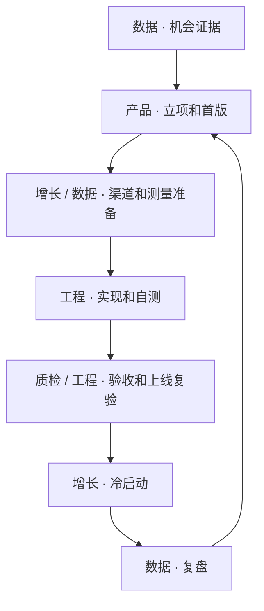

# Web 产品工作流

[English](README.md) · **简体中文**

一套面向独立开发者和小团队的 Agent Skill。把一个 Web 或 SaaS 机会，沿着竞品调研、产品立项、开发验收、冷启动和数据复盘推进。每项工作有一个负责人，交接时有明确的通过条件和证据。

## 谁适合用

- **个人开发者和小团队**。你已经有一个想做的 Web 产品，想让 AI 接手现有资料，尽快得到能检验的首版。
- **用 AI 开发的产品负责人**。你希望分清需求、实现和验收，减少新窗口里重复解释背景，以及改一处牵连其他功能的情况。
- **已经上线的站长**。你需要把试投、成功使用、付费和成本连起来，找出下一轮该改什么。

使用者需要提供项目目标和所需的访问权限。实际读写代码、运行测试、独立审查与部署能力取决于客户端及其工具。

## 怎么开始

1. 下载这个仓库。把 [`skills/web-product-workflow`](skills/web-product-workflow/) 整个文件夹放到目标项目的 `.agents/skills/`。确认项目里选用的是本版本的 Skill，尤其是已经装过同名 Skill 时。项目目录依据 [Codex 文档](https://learn.chatgpt.com/docs/build-skills)、[Trae 文档](https://docs.trae.cn/ide_skills) 和 [Kimi Code CLI 文档](https://www.kimi.com/code/docs/en/kimi-code-cli/customization/skills.html)。
2. 打开项目聊天，明确说“使用 web-product-workflow”。如果客户端没有发现它，也可以直接让 AI 读取 [SKILL.md 的中文入口](skills/web-product-workflow/SKILL.md#start-zh)和本次需要的参考小节。AI 按你指定的语言或当前对话语言选读资料。
3. 给出目标客户、核心任务、现有资料、本轮终点和授权范围。可选终点是基础准备、本地 MVP 或指定环境上线。已有 PRD、SPEC 或任务记录就直接引用。

> 使用 web-product-workflow。我要给自由职业者做一个发票整理工具。首版要把一批发票汇总成可下载的表格。现有项目说明在当前目录。本轮做到基础准备，交付可验收的首版范围、需要复用的组件和第一项工程任务。授权范围是本地准备和公开资料调研。

## 工作怎么接力

项目统筹贯穿各阶段。按任务唤醒当前岗位，兼职或分会话时仍保留独立验收。

- [岗位与交接](skills/web-product-workflow/references/roles.md)列出六岗各自的交付与通过条件。
- [工程与验收](skills/web-product-workflow/references/engineering.md)说明如何接手仓库、控制改动影响、检查失败路径及准备发布。
- [经营与数据](skills/web-product-workflow/references/operations.md)覆盖竞品证据、定价和额度、获客实验、单站及多站复盘。

遇到局部任务时，直接给任务和当前状态。涉及访问、花费或对外发布时，由用户提供明确的项目授权。

## 许可证

本仓库使用 [MIT 许可证](LICENSE)。
